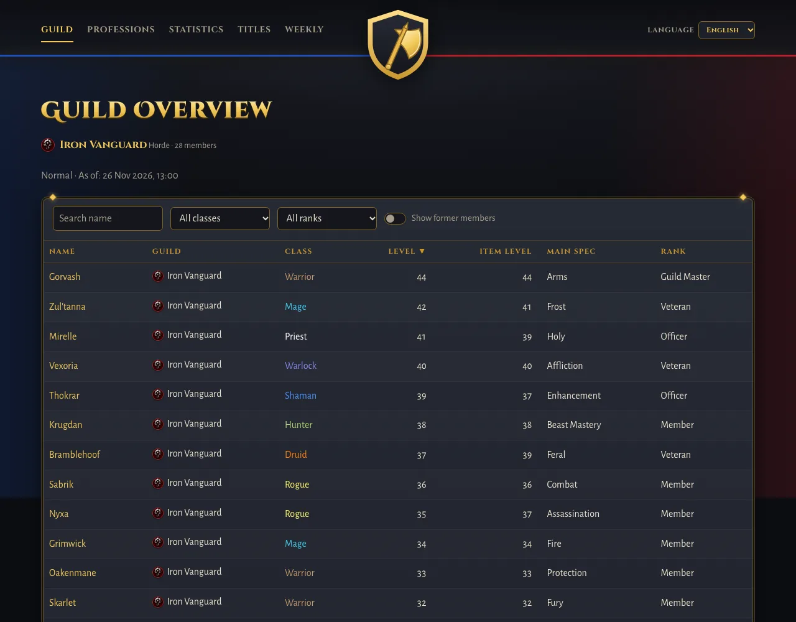
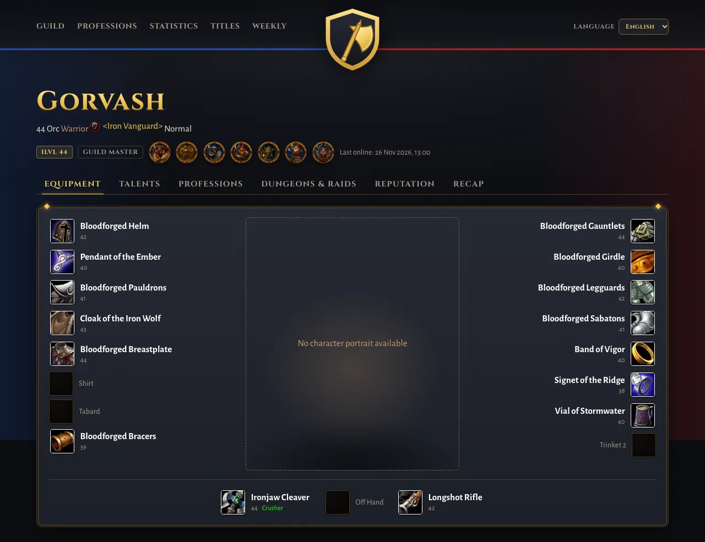
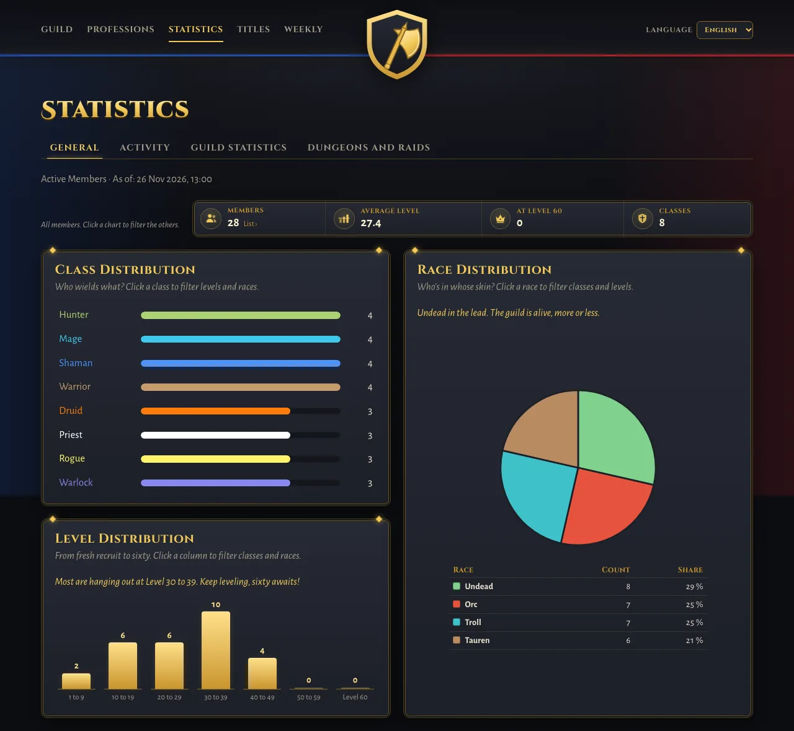
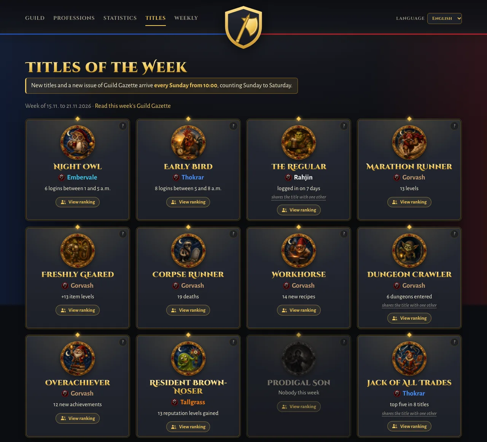
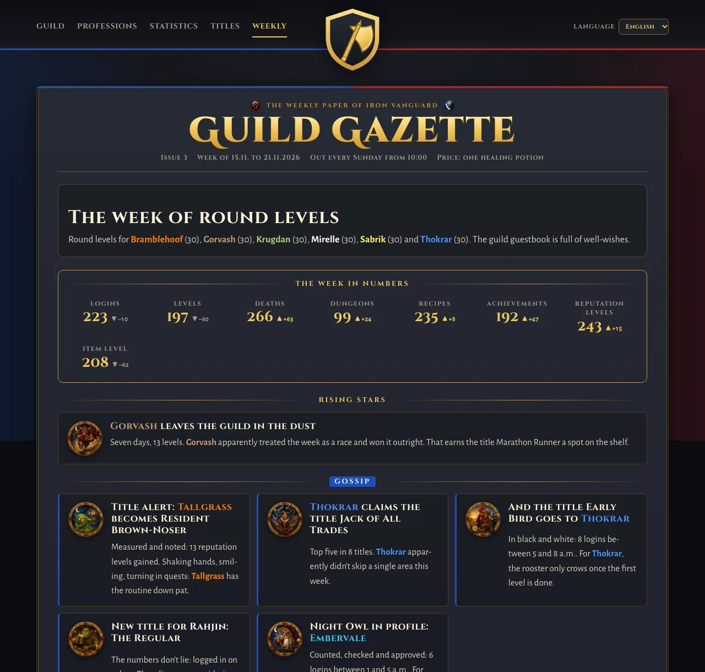
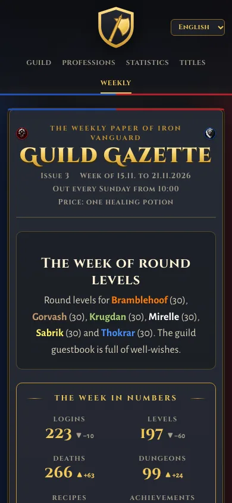

# WoW Guild Hub

🇩🇪 [Deutsch](README.de.md)

A website for your World of Warcraft guild: members, characters, professions, dungeons and raids, statistics,
weekly fun titles and a weekly guild newspaper of its own. The data comes hourly from the Blizzard API and is
stored in Netlify Blobs, no database needed. Fork, add your keys, done.

Built for a community of two guilds in WoW Forever, now open to every guild.

[](https://app.netlify.com/start/deploy?repository=https://github.com/geninOne/wow-guild-hub)
[](https://github.com/geninOne/wow-guild-hub/actions/workflows/ci.yml)
[](LICENSE)

## Screenshots

All screenshots show a made-up demo guild with sample data.

| Guild overview | Character page |
|---|---|
|  |  |
| **Statistics** | **Titles of the week** |
|  |  |
| **Weekly newspaper** | **On the phone** |
|  |  |

## Features

- **Guild:** all members with class, race, level, rank and item level, with filters and sorting. Several guilds
  (say, a Horde and an Alliance guild) can be combined into one community.
- **Character page:** gear with tooltips, stats like in the Armory (health, resource, primary stats, attack, spells,
  defense), talent trees, professions, reputation, progress in dungeons and raids,
  and a monthly review.
- **Professions:** a directory of all the guild's recipes, who can craft what, with materials.
- **Statistics:** class and level distribution, an activity heatmap, guild statistics as a wall of curiosities
  (week, month, all time), dungeons and raids of the whole guild.
- **Fun titles of the week:** twelve titles such as Night Owl, Early Bird or Jack of All Trades, with a hall of
  fame.
- **Weekly newspaper** (by default the "Guild Gazette", at `/zeitung`): published every Sunday with level-ups,
  records, new members, weather and a look back. The texts come from sentence templates or, with your own AI
  gateway, from Claude.
- **Languages:** German and English, optionally also Swabian and Bavarian.
- **Extensible:** modules for your own tabs, routes and newspaper articles, for example for data from your own
  addon (see [docs/extensions.md](docs/extensions.md)).
- **Privacy-friendly:** no cookies, no login, optionally Umami for simple visitor statistics.

Currently supported is **WoW Forever** (`WOW_VERSION=forever`). Retail and Classic with realms are planned.

## Installation in five steps

1. **Create a fork:** "Fork" at the top right on GitHub. Or use the "Deploy to Netlify" button above, which
   creates the fork and the Netlify site in one go (then continue with step 3).
2. **Create a Netlify site:** At [Netlify](https://app.netlify.com) choose "Add new site", "Import an existing
   project" and select your fork. Build command and folder are already set in `netlify.toml`.
3. **Get an API key from Blizzard:** Sign in to the
   [Battle.net Developer Portal](https://develop.battle.net/access/clients), click "Create Client" and enter a
   name (no redirect URL needed). Note down the client ID and client secret. Never show the secret to anyone and
   never commit it to the repository.
4. **Set environment variables:** In Netlify under "Site configuration", "Environment variables", set at least:

   | Variable | Value |
   |---|---|
   | `BNET_CLIENT_ID` | Client ID from step 3 |
   | `BNET_CLIENT_SECRET` | Client secret from step 3 |
   | `GUILD_SLUGS` | Slug of your guild, e.g. `my-guild` (lowercase, spaces as hyphens) |
   | `WEBSITE_NAME` | Name shown on the site |

5. **Style your guild and rebuild:** More settings such as logo, colors, rank names, languages, Discord and
   imprint are documented in [.env.example](.env.example). Then in Netlify go to "Deploys", "Trigger deploy".

Done. The collector runs hourly (`collect-guild`), static game data and the character stats every four hours
(`collect-static`, at half past, offset from the other runs), the weekly evaluation early on Sunday
(`collect-weekly`). After the first run, within an hour at the latest, there is data; the stats tab fills up over
the next few static runs.
If you don't want to wait, trigger the runs once by hand in Netlify under "Functions".

**Costs:** Netlify rebuilds on every push to `main`. To save credits, turn off automatic builds under
"Build & deploy" and publish only through the release workflow (see below).

## Configuration

Everything is configured through environment variables, no configuration file needed. The full, commented list
is in [.env.example](.env.example). The most important ones:

| Area | Variables |
|---|---|
| Required | `BNET_CLIENT_ID`, `BNET_CLIENT_SECRET`, `GUILD_SLUGS` |
| Game and API | `WOW_VERSION`, `BNET_REGION`, `BNET_LOCALE` |
| Guild | `GUILD_RANKS` (rank names as JSON), `TWINK_RANKS`, `TITLE_OPT_OUTS` |
| Appearance | `WEBSITE_NAME`, `WEBSITE_DESCRIPTION`, `WEBSITE_TAGLINE`, `WEBSITE_LOGO`, `WEBSITE_FAVICON`, `WEBSITE_OG_IMAGE`, `WEBSITE_COLORS` |
| Languages | `WEBSITE_LANGUAGES` (`de,en` or with `schwaebisch`, `bayrisch`), `WEBSITE_NEWSPAPER` |
| Legal | `WEBSITE_IMPRINT_NAME`, `WEBSITE_IMPRINT_ADDRESS`, `WEBSITE_IMPRINT_EMAIL` |
| Extras | `WEBSITE_DISCORD`, `WEBSITE_UMAMI_ID`, `WEBSITE_UMAMI_DOMAINS`, `NEWSPAPER_AI_URL`, `NEWSPAPER_AI_KEY` |

Notes:

- `WEBSITE_…` variables are applied at build time. Redeploy after changing them.
- Put your own images (logo, share image) in a folder of your own under `web/public/`, e.g.
  `web/public/my-guild/logo.png`, and enter them as `/my-guild/logo.png`. That way updates cause no conflicts.
- The imprint (Impressum, required in Germany) and the privacy policy only appear with `WEBSITE_IMPRINT_NAME`. Only
  **templates with placeholders** are included: name, address and email come from the variables, the texts you
  have to write and check yourself. Your own legal texts are best added as a module (`impressumSeite`,
  `datenschutzSeite`, see [docs/extensions.md](docs/extensions.md)), so they stay untouched when you update.
  Anyone running such a site in Germany needs both. This is not legal advice.
- `TWINK_RANKS` lists twink ranks by their name from `GUILD_RANKS`, comma-separated (e.g. `Twink,Twink GL`).
  WoW Forever reports account-wide achievements (class, professions, dungeon explorer) as completed on every
  character of the account. They then count only for characters without a twink rank. Without the variable they
  count everywhere.
- Netlify passes only about 4 KB of environment variables to the functions in total. Keep `GUILD_RANKS` short.
- The weekly newspaper is written by Claude when `NEWSPAPER_AI_URL` and `NEWSPAPER_AI_KEY` point to an
  Anthropic-compatible gateway. Without both, the sentence templates write it, free of charge.

## Local development

Requirement: Docker (or Node.js 22).

```bash
cp .env.example .env
```

Enter credentials and guild in `.env`, then:

```bash
docker compose up -d --build
```

The site runs at http://localhost:8888, reachable only from this machine. A scheduler in the container starts
the collectors as on Netlify (turn it off with `LOCAL_SCHEDULER=off`). By hand:

```bash
docker compose exec app npm run collect:guild
```

```bash
docker compose exec app npm run collect:static
```

```bash
docker compose exec app npm run collect:weekly
```

After changes to `package.json`, rebuild the container with fresh packages:

```bash
docker compose up -d --build --renew-anon-volumes
```

To try things out without a long wait, a script fills the local store with made-up activity (the pages then
show a red notice); `-- --remove` removes it all again:

```bash
docker compose exec app npm run data:sample
```

Only the interface with hot reload (without `/api`) at http://127.0.0.1:5173:

```bash
npm run dev:web
```

Check like the GitHub Action does:

```bash
npm run lint
```

```bash
npm test
```

```bash
npm run typecheck
```

```bash
npm run build
```

## Staying up to date

New versions appear as [releases](https://github.com/geninOne/wow-guild-hub/releases) with notes on what changed.
Versions follow [Semantic Versioning](https://semver.org/): patch for fixes, minor for new features, major when you
have to adjust something.

1. **Get notified:** on the [repository page](https://github.com/geninOne/wow-guild-hub) choose "Watch", "Custom",
   tick "Releases" and apply. GitHub then tells you about every new version.
2. **Read the release notes.** For a major version (e.g. 3.0.0), the section "Upgrade notes" lists new or renamed
   environment variables and steps on Netlify. Do these first.
3. **Update your fork:** on GitHub, "Sync fork" on the page of your fork brings in the latest `main` (possibly with changes that are not
   released yet). Or locally,
   pinned to exactly one version:

   ```bash
   git remote add upstream https://github.com/geninOne/wow-guild-hub.git
   ```

   ```bash
   git pull upstream v2.1.0
   ```

   Then push as usual. If you changed files yourself, Git may report conflicts; keep your own settings in
   environment variables and your own code in extensions (see above), then there are hardly any.
4. **Publish:** with automatic builds, Netlify deploys right after the push. Otherwise use the release workflow
   (below).

## Publishing via the release workflow (optional)

Instead of on every push, your site can go live only when you decide. To do so, turn off automatic builds on
Netlify and add in your fork on GitHub under "Settings", "Secrets and variables", "Actions":

- **Secrets:** `NETLIFY_AUTH_TOKEN`, `NETLIFY_SITE_ID`, `BNET_CLIENT_ID`, `BNET_CLIENT_SECRET`, optionally
  `NEWSPAPER_AI_KEY`
- **Variables:** `GUILD_SLUGS` and, as needed, all other settings from `.env.example`

Then "Actions", "Release", "Run workflow" on `main`. The workflow runs the checks, sets the Netlify variables and
deploys exactly that state. Pushing a tag `vX.Y.Z` that matches `package.json` does the same. The version number
comes from this repository; your fork does not bump it. Without the Netlify secrets the workflow deploys nothing,
and in this repository itself it never runs.

## Structure

| Folder | Contents |
|---|---|
| `netlify/functions/` | Read API (`/api/*`) and the scheduled collectors |
| `src/` | Collecting, processing, API, weekly evaluation, weekly newspaper |
| `web/` | Interface (Vite, React, React Router) |
| `config/` | Game data the API does not provide (dungeons, statistics, talent corrections, statistics cards) |
| `scripts/` | Tools for releases, sample data and data migration |
| `test/` | Tests (vitest) with recorded API responses |

## Contributing

Report bugs, share ideas, contribute code: see [CONTRIBUTING.md](CONTRIBUTING.md) and the
[Code of Conduct](CODE_OF_CONDUCT.md). Please report security vulnerabilities privately, see
[SECURITY.md](SECURITY.md).

## License and Blizzard

The code is licensed under the [MIT License](LICENSE).

This is a fan project. It is not affiliated with Blizzard Entertainment and is neither endorsed nor reviewed by
Blizzard. World of Warcraft and Blizzard Entertainment are trademarks or registered trademarks of Blizzard
Entertainment, Inc. Game data and images come from the Blizzard API and belong to Blizzard.

Whoever runs the site uses the Blizzard API with their own credentials and is responsible for complying with its
terms of use. As we understand it, this includes, for example, crediting Blizzard as the source, not charging
money for features that use API data, and not keeping stored data indefinitely without review. This is not legal
advice; only the current terms in the [Battle.net Developer Portal](https://develop.battle.net) apply.
